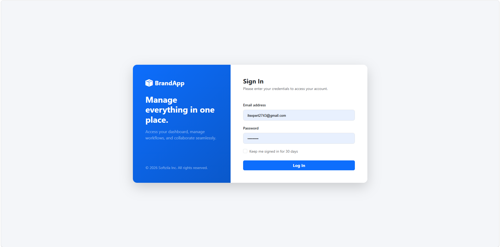
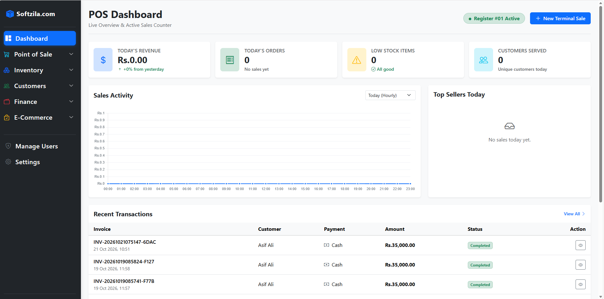
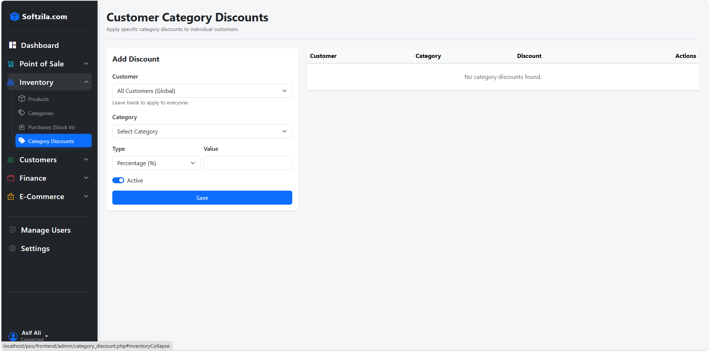
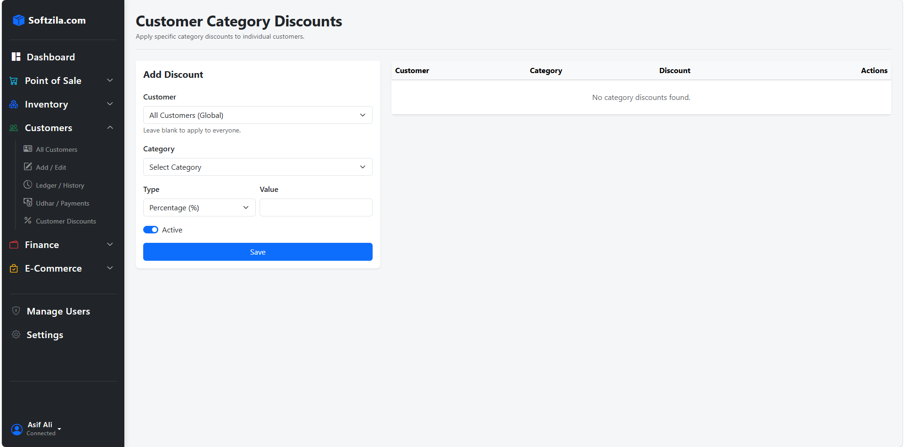

# Modern Point of Sale (POS) & Inventory System - PHP

A comprehensive, full-scale Point of Sale (POS) and business management system built with PHP. Designed for retail stores, this application handles everything from fast checkout and inventory tracking to complex financial reporting and customer credit management.

## 📸 Application Previews

### Secure Login Portal

*Secure authentication for Admins, Managers, and Cashiers.*

### Admin Dashboard & Analytics

*Real-time sales metrics, low-stock alerts, and daily summaries.*

| Inventory Management | Customer CRM & Credit |
| :---: | :---: |
|  |  |
| *Manage products, variants, and stock levels.* | *Track purchase history and customer Udhar (credit).* |

## 🚀 Comprehensive Feature List

### 🔐 1. User & Role Management (Security)
- **Role-Based Access Control (RBAC):** Distinct permissions for Admin, Manager, Cashier, and Inventory Manager.
- **Secure Authentication:** Password hashing and secure session management.
- **Audit Logs:** Track every action (refunds, inventory edits) by user.
- **Shift & Cash Drawer Management:** Open/close register sessions, track cash drops, and record shift sales.

### 📦 2. Product & Inventory Management
- **Product Catalog:** Complete CRUD operations for products, categories, and brands.
- **Variants Support:** Manage different sizes, colors, or weights of a product.
- **Barcode & SKU:** Auto-generate barcodes and unique SKUs.
- **Real-time Stock Tracking:** Inventory updates automatically upon sale or purchase.
- **Low Stock Alerts:** Visual notifications when items hit the reorder threshold.
- **Bulk Import/Export:** Upload and download inventory via CSV/Excel.

### 🛒 3. Point of Sale (Terminal)
- **Fast Checkout Interface:** Touch-friendly product grid with instant search.
- **Barcode Integration:** Add items to the cart instantly via USB scanners.
- **Multiple Payment Methods:** Cash, Card, Digital Wallets, and Bank Transfer.
- **Hold & Retrieve Orders:** Pause transactions to handle other customers.
- **Discounts & Taxes:** Apply fixed/percentage discounts and configurable tax rates.
- **Receipt Printing:** Support for 80mm/58mm thermal printers and A4 invoices.
- **Refunds & Returns:** Process full or partial refunds with mandatory reasons.

### 👥 4. Customer Management (CRM)
- **Customer Database:** Store contact info and track purchase history.
- **Credit / Udhar System:** Allow trusted customers to buy on credit, track balances, and record partial payments.
- **Loyalty Points:** Award and redeem points for purchases.
- **VIP Discounts:** Assign specific discount rates to wholesale or loyal customers.

### 🚚 5. Supplier & Purchase Management
- **Supplier Directory:** Manage vendor details and contact information.
- **Purchase Orders (Stock In):** Log incoming stock from suppliers.
- **Cost Tracking:** Automatically update product cost prices upon new purchases.
- **Accounts Payable:** Track money owed to suppliers.

### 💰 6. Financial Management
- **Expense Tracking:** Record daily business costs (rent, utilities, salaries).
- **Profit & Loss (P&L):** Calculate Gross Profit (Sales - COGS) and Net Profit.
- **Cash Flow Tracking:** Monitor money in (sales) vs. money out (expenses).

### 📊 7. Reporting & Analytics
- **Dashboard:** Daily sales, top-selling products, and low-stock alerts.
- **Sales Reports:** Filter by date, cashier, payment method, or customer.
- **Inventory Reports:** Stock valuation and dead stock identification.
- **Tax Reports:** Summary of collected taxes for accounting.
- **Data Export:** Export reports to PDF or Excel/CSV.

### ⚙️ 8. System Settings
- **Business Details:** Set store name, logo, and contact info.
- **Receipt Customization:** Choose templates, toggle logos/QR codes, add footer messages.
- **Localization:** Configure currency symbols, tax rates, and date formats.
- **Backup & Restore:** Database backup functionality.

### 🔌 9. Hardware Integrations
- **Barcode Scanners:** Plug-and-play USB support.
- **Thermal Receipt Printers:** ESC/POS support.
- **Cash Drawers:** Auto-trigger to open upon cash sales.
- **Weighing Scales:** Integration for items sold by weight.

## 🛠️ Tech Stack
- **Backend:** PHP (Modular Architecture)
- **Database:** MySQL
- **Frontend:** HTML5, CSS3, JavaScript
- **Dependency Manager:** Composer

## 📂 Project Structure

```text
POS/
├── assets/              # CSS, JS, and image files
├── backend/             # Core PHP logic (Modular)
│   ├── account/
│   ├── admin/
│   ├── auth/
│   ├── category/
│   ├── customer/
│   ├── employee/
│   ├── product/
│   ├── sale/
│   └── settings/
├── config/              # Database connection and app constants
├── database/            # SQL schema and migration files
├── frontend/            # Views, UI templates, and Layouts
├── vendor/              # Composer dependencies (Ignored in Git)
├── .htaccess            # Apache configuration
├── composer.json        # PHP package dependencies
└── index.php            # Application entry point
